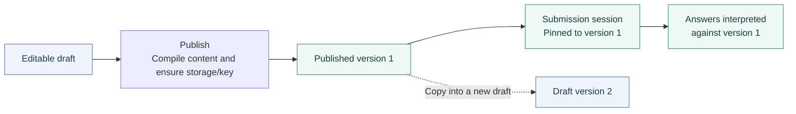
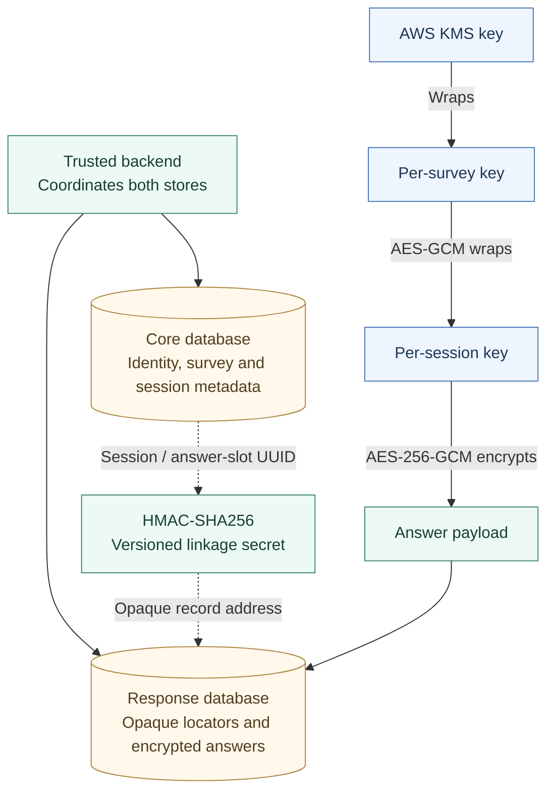

# FlowForm engineering tour

[Start with the project README](README.md) for the product introduction and demo. This tour follows the engineering decisions behind that experience, then identifies the places still being developed.

This tour was checked against source commit `8792a9049670f4c52d27e391ac24be54627b0e97`. The diagrams describe application responsibilities and data relationships; they are not diagrams of an independently verified live deployment.

## 1. One builder, several environments

The public site uses Astro for its page content and mounts the shared React builder as an interactive island. Its draft lives in `localStorage`; preview state uses `sessionStorage`. It needs no backend connection.

Studio supplies a different integration around the same builder: loading a survey version, checking permissions, saving changes through the API, and invoking publication. The respondent page adapts the shared form filler to submission-session APIs. That respondent route currently belongs to the Studio build, rather than Astro.

This keeps the question UI and rule evaluator reusable while leaving storage and access decisions with each host. The cost is an important integration boundary: a working browser preview does not establish that publication, compiled references, and persisted answers all agree.

**Follow the code:** [public demo adapter](frontend/apps/public-site/src/components/NodePageIsland.tsx), [Studio builder controller](frontend/apps/studio-app/src/pages/SurveyWorkspaceTabPages/useSurveyBuilderController.ts), [respondent adapter](frontend/apps/studio-app/src/pages/RespondPage.tsx).

## 2. Publishing preserves the question behind an answer

An editable draft and an active published survey have different responsibilities. Publishing compiles the stored nodes and scoring rules into a version snapshot and ensures the response store and wrapped survey key exist. A submission session points to the version selected when it starts.

PostgreSQL triggers reject edits to published question and scoring rows, alongside the application's draft-only mutation rules. These constraints protect historical content independently of the editor interface. They do not establish that every authored rule graph is valid.

**Follow the code:** [publication service](backend/app/services/surveys.py), [version repository](backend/app/repositories/surveys_repo.py), [database constraints and triggers](infra/database/init/schema/flowform_core_db_schema_v4.sql).

## 3. Separate metadata from encrypted answer values

The core database holds users, projects, surveys, versions, access records, sessions, and answer slots. An answer slot identifies a session/question relationship; it does not hold the answer value.

The response database holds response-local envelopes, wrapped session keys, encrypted current answers, and limited operational metadata such as update timestamps. It has relationships within its own schema, but no SQL foreign keys back to core users, projects, or surveys.

The backend connects the stores using opaque addresses derived with HMAC-SHA256 and a versioned linkage secret. Session locators derive from core session UUIDs; answer locators derive from core answer-slot UUIDs. These are keyed locators, not hashes of a respondent's email address.

*Solid key-chain arrows mean cryptographic wrapping or encryption. Dotted arrows describe application linkage. Plaintext survey and session keys can exist in trusted backend memory.*

The backend creates a random 32-byte survey key and wraps it with KMS using project/survey context. That key wraps each session's random key; the session key encrypts answer payloads with fresh nonces and authenticated context. Wrapped survey keys live in core; wrapped session keys live in response envelopes.

For authorised results, the backend resolves the slots, fetches ciphertext, unwraps the necessary keys, and decrypts requested values. This design reduces what either database contains on its own. It is **not end-to-end encryption**, and it does not protect answers from a fully compromised backend with the required permissions and key access.

**Follow the code:** [locator derivation](backend/app/crypto/_internal/locators.py), [survey-key lifecycle](backend/app/crypto/survey_key.py), [cryptographic operations](backend/app/crypto/_internal/wrapping.py), [response schema](backend/app/schema/orm/response), [authorised results decryption](backend/app/services/admin_results/core/decryption.py).

## 4. Contracts cross the Python–TypeScript boundary

Pydantic models describe API inputs and outputs. The OpenAPI machinery combines schema definitions with registered Flask route metadata. Frontend generation produces TypeScript API types and builder-specific types, constraints, JSON Schema, and Zod validators.

This reduces manual duplication when a question shape changes. It also makes the complete import contract available to AI-assisted survey generation instead of relying on a few incomplete examples. Generated validators still need to be called; a TypeScript type alone does not validate untrusted JSON at runtime.

**Follow the code:** [OpenAPI builder](backend/app/openapi/spec.py), [frontend generator](frontend/scripts/generate-types.mjs), [shared schema package](frontend/packages/schema/src), [contract drift check](scripts/ci/check-openapi-contracts.sh).

## 5. Login, permission, and invitation are different decisions

Auth0 establishes the operator's identity. FlowForm's own access services determine project and survey permissions. For example, results endpoints require authentication and the `submission.view` permission before reaching the result/decryption services.

Respondent entry has its own policy: survey visibility, invitation state, participant assignment, and identity requirements. A recognition credential helps identify a returning browser; it is not permission to access any survey. A resume credential belongs to a particular attempt.

**Follow the code:** [access service](backend/app/services/access/access_service.py), [results routes](backend/app/api/v1/studio/surveys/results.py), [respondent services](backend/app/services/public_submissions).

## 6. Check persistence as well as presentation

The maintained backend runner uses Docker with real core and response PostgreSQL databases. The normal suite excludes tests that call live external providers. Studio also has Vitest tests; both frontend applications have lint and build checks. CI includes contract drift, security, and infrastructure checks, with path-based selection for some jobs.

This combination can check database constraints, typed contracts, and selected interaction behaviour. It does not replace deployment smoke tests or a complete respondent journey against configured identity and key services. No new full-stack or live-cloud test run was performed for this documentation update.

**Follow the code:** [test runner](backend/scripts/run-tests.sh), [backend tests](backend/tests), [Studio tests](frontend/apps/studio-app/tests), [CI workflow](.github/workflows/ci.yml).

## Current boundaries

These are concrete integration concerns visible in the reviewed implementation:

- **Published rule references:** the compiler emits `node_id`, while authored rules refer to editable `node_key` values. The respondent adapter substitutes `node_id` as the runtime key. Those representations need a consistent, tested mapping before published branching can be treated as reliable across all cases.
- **Completion validation:** the backend checks individual saved answers but does not yet reconstruct the complete rule graph and enforce all final requiredness constraints when completing a session.
- **Answer history:** a new answer save replaces the current ciphertext for that slot. Published survey history is preserved; an immutable history of every answer edit is not implemented.
- **Transactions:** core and response writes have separate commit boundaries. They are coordinated explicitly by the service layer rather than one distributed transaction. Draft saves also consist of multiple API mutations.
- **Operations:** infrastructure definitions, deployment automation, and static checks do not prove current production configuration, recovery readiness, or service availability.

Broader workflow automation, scheduled reminders, and follow-up orchestration remain product direction, rather than capabilities established by these source paths.

## Visual evidence

The README's [homepage screenshot](docs/assets/readme/homepage.png) was captured on 27 October 2026 from a local production build at that commit, using a clean browser, light theme, and a 1440-pixel viewport. Its example contains synthetic data. The rules and matching recordings are the existing application assets in `frontend/apps/public-site/public/screenshots/`, reused without modification. These visuals demonstrate the interface, not backend or deployment verification.
