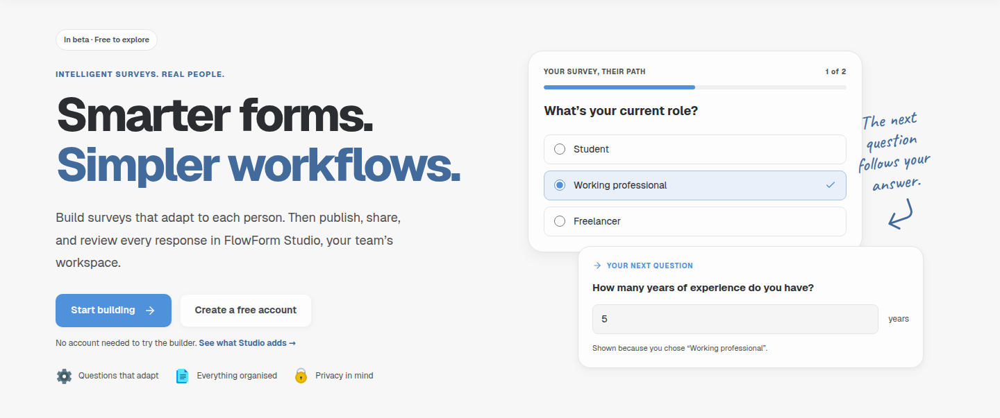
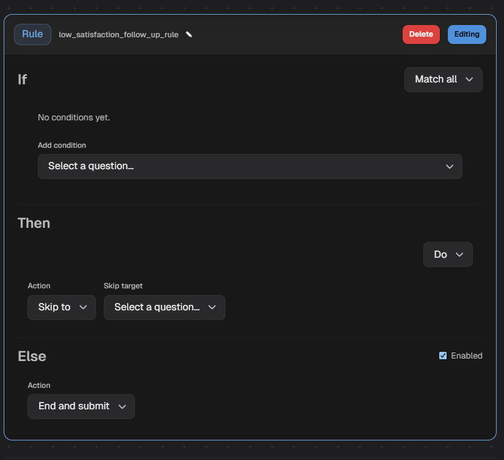
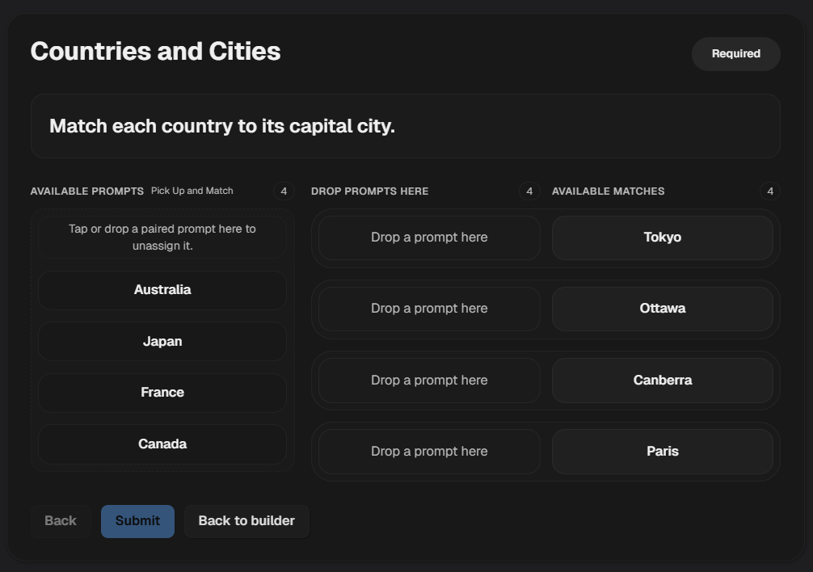
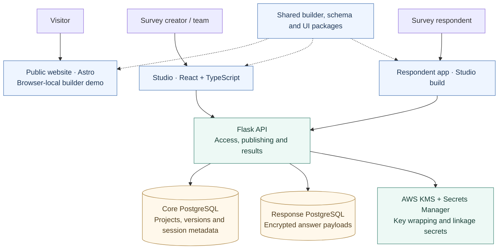

# FlowForm

### Surveys that adapt to the people answering them.

Build a survey, choose what happens after each answer, and guide people through the questions that matter to them. FlowForm brings the builder, publishing, participant access, and response review into one project workspace.

**[Try the builder](https://flow-form.com.au/#builder)** · **[Visit the website](https://flow-form.com.au)** · **[Read the engineering tour](ENGINEERING_TOUR.md)**

[](https://flow-form.com.au)

*The public website, captured from this repository. The interactive example shows how an answer can change the next question.*

## Why build FlowForm?

A questionnaire rarely needs to ask everyone exactly the same things. A student and a working professional may need different follow-ups. A research team may need to revise a survey while keeping earlier responses meaningful. Some invitations can be shared openly; others belong to a particular participant.

FlowForm brings these concerns together: a flexible experience for the person answering, and a structured workspace for the person running the survey.

It is an independently developed, full-stack project spanning the interface, survey logic, API, database design, access controls, encryption, and infrastructure tooling.

## Take a quick look

**No account is needed for the [public builder demo](https://flow-form.com.au/#builder).**

1. Open the example survey and inspect its questions and rule.
2. Select **Preview form**, then choose **Working professional**.
3. Select **Continue** to see the experience question. Go back and try another answer to see the path change.
4. Return to the builder to edit the example or add your own questions.

The demo saves its draft in your browser. It does not create a Studio project, publish a survey, or send answers to the backend. Use the website's **Create a free account** or **Sign in to Studio** links to explore the full application.

## From a question to a useful response

| Step | What it means |
| --- | --- |
| **Build** | Combine choices, written answers, numbers, dates, ratings, and matching questions. |
| **Adapt** | Use earlier answers to show a follow-up, make a question required, or skip ahead. Preview the journey as you build. |
| **Publish** | Turn a draft into a fixed version. Keep working on the next draft without rewriting the version people already answered. |
| **Share** | Choose public, link-only, or participant-assigned access to suit the survey. |
| **Review** | Inspect or export responses in Studio, with each attempt tied to the survey version that collected it. |

### See the builder in action

[](https://flow-form.com.au/#builder)

*An actual product recording. If your Markdown viewer pauses animated PNGs, open the image or try the live demo.*

<details>
<summary>See matching questions in action</summary>



Matching questions let people connect related items with drag-and-drop or click-to-place interactions.

</details>

## More than a form editor

**Keep work organised.** Projects group surveys and participants. Team permissions determine who can edit content, publish surveys, manage access, and review results.

**Keep published meaning intact.** A response belongs to an exact published version, so a later draft does not silently change the questions behind an earlier answer.

**Give response data deliberate protection.** Answer values are encrypted before storage and kept in a separate database from account, project, and participant records. The authorised backend connects those records when results are requested.

Authorised users can still read results through the application. Separating and encrypting stored answers does not promise complete anonymity.

## Project status

**Beta · Active development.** The public demo provides a hands-on introduction to the shared builder. The repository also contains Studio, the respondent application, the API, encrypted persistence, automated checks, and deployment tooling.

Work continues on checking every path through a published survey and validating completed responses. Automated reminders and broader workflow automation are future direction. The [engineering tour](ENGINEERING_TOUR.md#current-boundaries) explains what still needs work.

---

## How it fits together

The public website introduces the product. **Studio** is the management application and currently also hosts the respondent experience. Both reuse the same survey-building components, while the Flask API owns permissions, publishing, and durable data.



*The public demo runs locally in the browser. Persistent survey operations go through the API. The database boxes represent logical stores, not a claim about separate physical servers.*

## Engineering decisions worth exploring

| Decision | Why it matters |
| --- | --- |
| **Published snapshots** | Preserve the meaning of collected responses while authors continue editing. |
| **Shared builder and runtime** | Reuse authoring and form-filling behaviour across the demo and application. |
| **Generated API contracts** | Carry backend schemas into TypeScript types, builder constraints, and runtime validators. |
| **Explicit response protection** | Separate identity-bearing metadata from encrypted answers, with decryption behind authorised results requests. |
| **Server-side access decisions** | Treat login, team permissions, and participant invitations as separate responsibilities. |
| **Tests with real PostgreSQL** | Exercise database constraints and persistence behaviour alongside unit and frontend tests. |

For diagrams of publishing, encryption, and the main tradeoffs, continue with the **[engineering tour](ENGINEERING_TOUR.md)**.

## Technology at a glance

| Area | Main tools |
| --- | --- |
| Public website | Astro, React islands |
| Studio and respondent UI | React, TypeScript, Vite, TanStack Router and Query |
| Shared interface | Tailwind CSS, workspace UI and design tokens |
| Backend | Python, Flask, Pydantic, SQLAlchemy |
| Persistence and identity | PostgreSQL, Auth0 |
| Answer protection | AES-256-GCM, AWS KMS, HMAC-SHA256 locators |
| Tooling | pnpm workspaces, uv, OpenAPI, pytest, Vitest, GitHub Actions |

## Explore the repository

```text
frontend/
  apps/public-site/     Marketing, documentation and local builder demo
  apps/studio-app/      Management UI and respondent experience
  packages/            Shared builder, schema, UI, styles and site shell
backend/app/           API routes, services, repositories and cryptography
backend/tests/         Unit, integration and end-to-end tests
infra/                 Database schemas, containers and deployment definitions
scripts/               Development, contract and documentation tooling
docs/                  Architecture, domain explanations and workflows
```

## Project checks

The CI workflow defines security scanning, backend lint/type checks and PostgreSQL-backed tests, Studio lint/tests/build, the public-site build, contract drift checks, and infrastructure checks. Some jobs are selected by changed paths. These are declared checks; their presence is not a claim that every current branch or deployment has passed them.

Continue with the **[engineering tour](ENGINEERING_TOUR.md)** for the implementation decisions, publishing and encryption diagrams, source entry points, and current limitations.

Questions about the project? [support@flow-form.com.au](mailto:support@flow-form.com.au)
