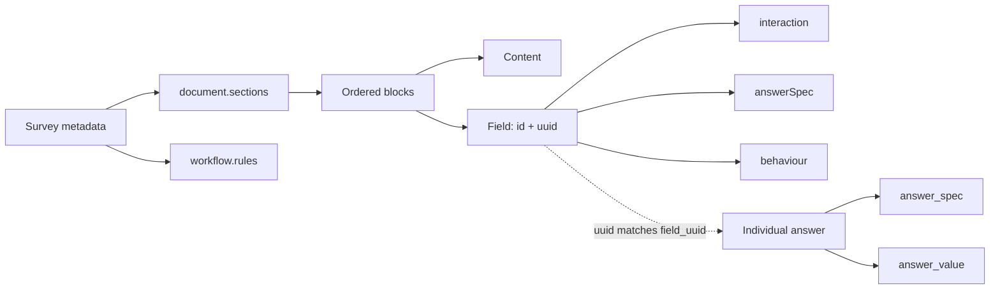

# Survey document visual guide

[Open the short visual presentation](assets/survey-document-visual-guide.pdf).
The authoritative data shapes remain the V2 [survey](flowform-v2-survey-document-definition.md)
and [answer](flowform-v2-answer-data-definition.md) definitions.

## The model at a glance

| Part | What it represents |
| --- | --- |
| Survey | Identity, version, revision, title, project and status. |
| Document | Ordered sections and blocks. |
| Field | A question with readable ID, UUID, prompt, interaction and accepted-value specification. |
| Behaviour | Local visibility using field/option UUID references. |
| Workflow | Survey-level conditions and outcome identifiers; execution semantics are separate. |
| Answer | One field UUID, mutation ID, state, specification and value. |

## Identity and values

Structural elements use readable `id` values. Fields and selectable options also
carry stable `uuid` values. Moving a block changes order, not answer identity.
`id` replaces the earlier separate `key`; typed ULIDs are no longer the target.

`interaction` describes entry and presentation. `answerSpec` describes accepted
values. A numeric input and a rating can accept the same integer value.

On answer submission the corresponding property is snake_case `answer_spec`.
The value does not include question wording, labels or presentation settings.

## Answered, cleared and complete

| Operation | Shape |
| --- | --- |
| Answered | `field_uuid`, `client_mutation_id`, `state: answered`, `answer_spec`, `answer_value`. |
| Cleared | Same identity fields and `state: cleared`; no answer_value; answer_spec may be omitted. |
| Complete | Separate `{ "action": "complete" }`; no resubmitted answer collection. |

The specification accompanies an answered value so it can be interpreted without
loading the full survey. It remains client-provided data, not proof of the
published field's constraints. Storage, encryption and verification are not
specified by these logical objects.

## Examples and comparison

[Survey JSON](assets/survey-document-example.json) ·
[Numeric answer](assets/survey-document-feedback-response.json) ·
[Choice answer](assets/survey-document-response-example.json) ·
[Completion](assets/survey-completion-example.json)

For current-versus-V2 data examples, use the
[data comparison](survey-document-data-structure.md) and its
[HTML presentation](assets/flowform-data-structure.html).

The previous prototype response aggregate, answer revision counters and automatic
early-exit examples have been removed from these reading aids. They are not
requirements in the current V2 answer definition. Structured matching, ranking
and matrix values require explicit answer specifications.
